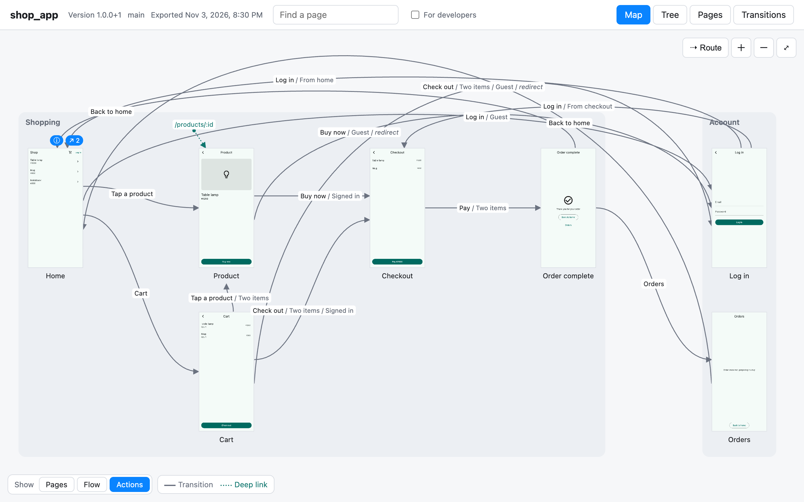
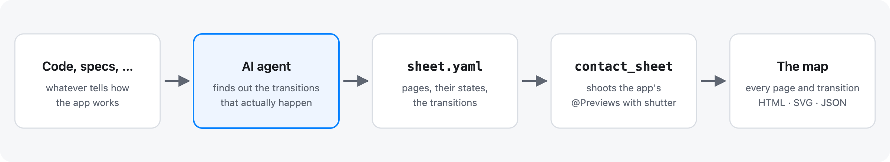
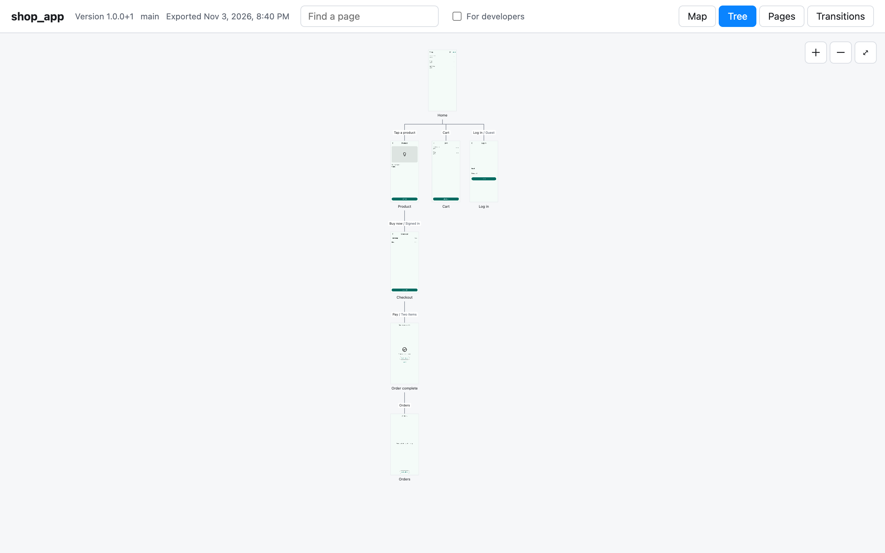

Every page of a Flutter app as one map: each state of each page as an image, each transition as an arrow.
The map is HTML, SVG and JSON, opened without any tool, for everyone who works on the app, whether in its code or not: product managers, designers, marketing, support.



**See it:** [the maps of the example apps](https://koji-1009.github.io/contact_sheet/), exported from the examples in [the repository](https://github.com/koji-1009/contact_sheet).

## How it works



1. An AI agent finds out the screen transitions that actually happen in the app, from whatever tells how the app works (its code, its specifications), and writes them as the app's **sheet** (`contact_sheet/sheet.yaml`), naming a `@Preview` for each state of each page.
2. `contact_sheet export` shoots those previews with [shutter](https://pub.dev/packages/shutter), drawn as iOS (or Android, where the sheet asks for it), and draws the map.

The previews are the app's own where it has them (a team on shutter or the Widget Previewer has one per page).
For the pages and states the app has none of, the agent writes them in the **sheet package**, a small Flutter package in `contact_sheet/` that imports the app.
The app's code is never changed.
Contact Sheet draws the sheet as it is: it does not check it against the app.

## What the map shows

- Every page, grouped by section, with the transitions between them and the deep links into them; each page's first state on the map, all its states (as a guest or signed in; empty; loading) when it is chosen and in the list.
- A page chosen: its memo, its links, its states, and its transitions as sentences ("When Guest, tap “Log in” → Log in (From home)"). An arrow tapped: what it is, as a sentence.
- How much it shows: the pages alone, with the arrows, or with what each arrow says; the arrows back shown or hidden.
- The tree: the pages top to bottom, as a site map draws an app, each under the page the app's start first reaches it from.
- The route between two pages: the fewest steps as the app's navigator goes. It follows redirects, what the app keeps across its pages (signed in, the cart) and the tabs' own histories.
- A list of the pages, a table of the transitions, search, and an address to pass around for each page, state and route.
- Variants, where the sheet names them: iOS or Android, phone or tablet.
- What only developers read (the code's names and files) is behind “For developers”.
- Light and dark, a phone's width, and print.



`contact_sheet/map/` holds:

- `index.html`, with the images in `images/` next to it: opened from disk or served anywhere.
- `map.svg`: the whole map as one picture; `map-dev.svg`, with what developers read too.
- `sheet.json`: what they are drawn from, for other tools and AI agents.

## Requirements

- Flutter 3.47 or later (Dart 3.13 or later), as shutter needs.
- `flutter_test` in the app's `dev_dependencies`, as shutter shoots the previews in `flutter test` (the sheet package has it).
- An AI agent to write the sheet: any that runs commands, such as [Claude Code](https://claude.com/claude-code) or [Codex](https://github.com/openai/codex).

shutter comes with the command: nothing else to install.

## Getting started

1. Install the command (`dart install` compiles it to a native binary on the PATH):

   ```sh
   dart install contact_sheet
   ```

2. In the app's directory, ask the AI agent to run `contact_sheet agent` and follow it.
3. Open `contact_sheet/map/index.html`.

## Commands

| Command | What |
| --- | --- |
| `contact_sheet agent` | Prints the playbook the AI agent follows to write the sheet |
| `contact_sheet manual` | Prints the reference: the sheet's fields, the map, the exit codes |
| `contact_sheet init` | Writes an empty sheet; with `--package`, the sheet package's skeleton too |
| `contact_sheet export` | Shoots the previews the sheet names and writes the map into `contact_sheet/map/` |
| `contact_sheet lint` | Tells what the sheet may be missing or have written twice |
| `contact_sheet basis` | Records the app as it is now as what the sheet was written against |
| `contact_sheet changed` | Lists the app's files changed since then: the sheet may need bringing up to date for them |
| `contact_sheet prune` | Deletes shutter's runs that Contact Sheet left |

`contact_sheet help <command>` tells a command's options.
An export deletes the runs of shutter's it made, so the team's own runs in the app stay as they were.

## In the app's repository

Contact Sheet adds `contact_sheet/` to the app, and with `init --package`, a line to its `.gitignore`:

- `sheet.yaml` and `basis.json`, and the sheet package where there is one: kept in git.
- `map/`: the map, mostly images (about 1.3 MB for the shop example's 11 states). Commit it, or ignore it and export it where it is shared (`export --out <folder>`), or have CI export it.
- `.dart_tool/`: what an export keeps between runs, and the sheet package's shots: out of git. Flutter's `.gitignore` ignores `.dart_tool/` at any depth; where the app's `.gitignore` does not, `init --package` adds `contact_sheet/.dart_tool/` to it.

## More

- [The manual](https://github.com/koji-1009/contact_sheet/blob/main/doc/manual.md): the sheet's fields, the map, `sheet.json`, the commands' options and exit codes.
- [The playbook](https://github.com/koji-1009/contact_sheet/blob/main/doc/agent.md): what the AI agent follows.
- [The examples](https://github.com/koji-1009/contact_sheet/tree/main/example): three apps and their sheets (go_router, Navigator 1.0, bottom tabs), each with its previews from a different place.
- [The changelog](https://github.com/koji-1009/contact_sheet/blob/main/CHANGELOG.md).
- Problems and ideas: [the issues](https://github.com/koji-1009/contact_sheet/issues).
- Working on Contact Sheet itself: [doc/development.md](https://github.com/koji-1009/contact_sheet/blob/main/doc/development.md).

## License

MIT ([LICENSE](https://github.com/koji-1009/contact_sheet/blob/main/LICENSE)).
